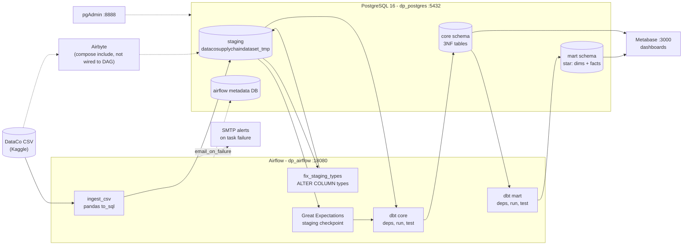
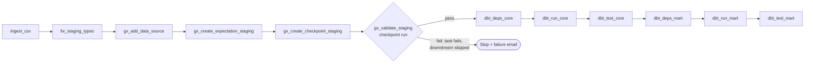
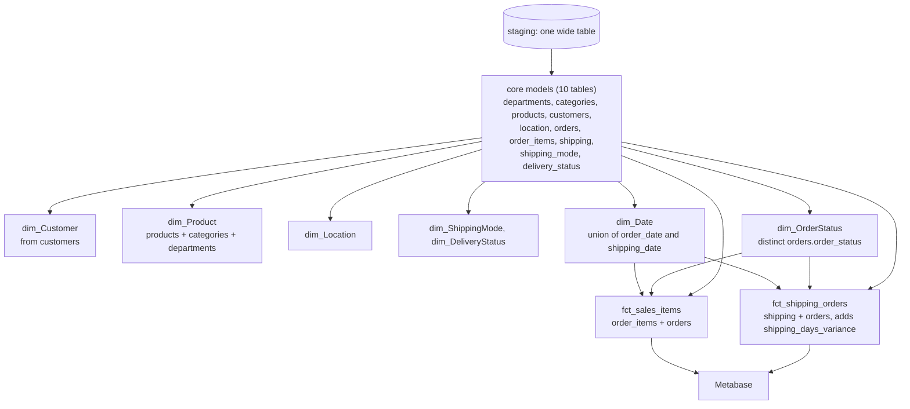
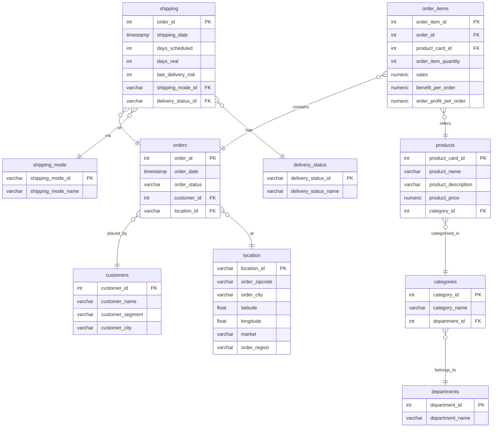

# DataCo Supply Chain Analytics Pipeline

**End-to-end data pipeline: ingest a supply-chain CSV into Postgres, model it (3NF core, then star-schema marts) with dbt, validate it with Great Expectations, orchestrate it with Airflow, and explore it in Metabase.**

     

> **Demo/Slide video:** <https://www.youtube.com/watch?v=dO6Y7ipzRO0>
> **Dataset:** DataCo SMART SUPPLY CHAIN FOR BIG DATA ANALYSIS (Kaggle): <https://www.kaggle.com/datasets/shashwatwork/dataco-smart-supply-chain-for-big-data-analysis>

> **Status: course data-engineering project (local Docker, dev credentials).** The orchestrated path in the DAG is CSV (pandas) -> Postgres staging -> Great Expectations -> dbt core -> dbt mart. Some items in the original README were aspirations rather than what the code does today; this version marks them. See [What is implemented vs. planned](#what-is-implemented-vs-planned).

Last updated: 2026-11-03.

---

## Table of contents

- [Thai overview](#project-overview-th)
- [Problem and goals](#problem-and-goals)
- [Repository layout](#repository-layout)
- [Tech stack](#tech-stack)
- [System architecture](#system-architecture)
- [Airflow DAG flow](#flow-1-airflow-dag)
- [KPIs](#kpis)
- [Core schema (3NF)](#core-database-schema-3nf)
- [Data mart schema (star)](#data-mart-schemas-star)
- [Data quality](#data-quality-great-expectations)
- [Quickstart](#quickstart)
- [Implemented vs. planned](#what-is-implemented-vs-planned)
- [Security and limitations](#security-and-limitations)
- [Roadmap](#roadmap)

---

## Project overview (TH)

### 1) บริบทธุรกิจ (Business Context)

* **อุตสาหกรรม:** ค้าปลีก/E-commerce แบบ Global
* **ตลาดหลัก:** USCA, LATAM, Europe, Pacific Asia, Africa
* **ลูกค้า:** Consumer, Corporate, Home Office
* **กระบวนการหลัก:** Order -> Payment -> Fraud Detection -> Shipping
* **ความท้าทาย:** ส่งมอบตรงเวลา (Late_delivery_risk) และรักษากำไรต่อออเดอร์

### 2) เป้าหมายทีม Data (Data Team Goals)

* สร้าง **Single Source of Truth (SSOT)** ผ่าน DWH (Core 3NF)
* สนับสนุน **Logistics**: Dashboard OTD/สาเหตุความล่าช้า
* สนับสนุน **Sales & Finance**: Sales/Profit Drill-down ตามภูมิภาค/สินค้า/เซ็กเมนต์
* สนับสนุน **Marketing**: วิเคราะห์พฤติกรรมลูกค้า/ผลของส่วนลด
* สนับสนุน **Risk**: แจ้งเตือน/แดชบอร์ด **SUSPECTED_FRAUD**

### 3) SLA / Schedule (เป้าหมายตามเอกสารโครงการ)

* ข้อมูลพร้อมใช้งาน **ก่อน 08:00** ทุกเช้า
* **Transform + Validate + Publish** ทุก **1 ชั่วโมง**
* แจ้งเตือนทีม Data/BI ผ่าน Email เมื่อเสร็จสิ้นหรือเกิดขัดข้อง

> หมายเหตุ: ใน DAG ปัจจุบัน `schedule_interval=None` (รันด้วยมือ) และ task "publish" ทางอีเมลถูกคอมเมนต์ไว้ จึงเป็นเป้าหมายการออกแบบ ยังไม่ได้ถูกบังคับใช้โดยโค้ด ส่วนอีเมลแจ้งเมื่อ task ล้มเหลวถูกตั้งไว้ใน `default_args`

---

## Problem and goals

A global e-commerce retailer needs on-time delivery and healthy margin per order. Raw data arrives as one wide denormalised CSV, which is hard to query and impossible to trust without checks. The project builds a single source of truth (3NF), purpose-built star schemas for fast KPI queries, automated data-quality gates, and dashboards for Logistics, Sales and Finance, Marketing and Risk teams.

SLA targets (design intent): data ready before 08:00 each morning; transform, validate and publish hourly; email notification to Data/BI on completion or failure.

## Repository layout

```
Pj-Data-Pipeline/
├── DataCoSupplyChainDataset.csv        raw data (also mounted into Postgres/pgAdmin containers)
├── docker-compose.yml                  postgres, pgadmin, metabase, dbt, gx, db_init, airflow (+ Airbyte include)
├── dockerfile.airflow                  Airflow 2.9.3 + dbt-core/postgres 1.9.1 + Great Expectations 0.18.8
├── dockerfile.gx                       Great Expectations 0.18.15 helper container
├── postgresql.conf
├── airbyte/                            Airbyte docker-compose, flags, temporal config
├── airflow/
│   ├── dags/DataCo_pipeline_DAG.py     DAG dataco_supply_chain_pipeline
│   ├── dags/data/DataCoSupplyChainDataset.csv
│   └── logs/                           run logs committed to git (should be ignored)
├── dbt/
│   ├── supply_chain_core/              3NF models: 10 tables + schema.yml tests
│   └── supply_chain_mart/              star schema: 7 dims + 2 facts + schema.yml tests
├── dbt_root/profiles.yml               dbt profiles for both projects (target dev)
├── gx/                                 GX context: checkpoint, staging expectation suite, data docs styles
├── gx_scripts/                         add_datasource, create_*_expectations, create_*_checkpoint
└── (Thai-named PDF)                    project brief
```

## Tech stack

<p align="center">
  
</p>

| Layer | Choice (from compose, Dockerfiles, DAG) |
|---|---|
| Orchestration | Apache Airflow 2.9.3, LocalExecutor, DAG `dataco_supply_chain_pipeline`, timezone Asia/Bangkok |
| Ingestion | pandas 1.5.3 + SQLAlchemy 1.4.46 `to_sql` inside the DAG. Airbyte is included via `docker-compose.yml` but is not called by the DAG |
| Storage | PostgreSQL 16 (db `dp_course`; schemas `staging`, `core_core`, `mart_mart`) |
| Transform | dbt-core 1.9.1 + dbt-postgres 1.9.1 (two projects: core and mart) |
| Data quality | Great Expectations 0.18.8 (Airflow image) / 0.18.15 (GX image) |
| BI | Metabase (container on port 3000) |
| Admin | pgAdmin 4 (port 8888) |
| Alerts | Airflow SMTP settings pointing at a Mailtrap sandbox host (dev) |

---

## System architecture



## Flow 1: Airflow DAG

Task order is a single linear chain taken from `DataCo_pipeline_DAG.py`:



What each step does:

| Task | Operator | Action |
|---|---|---|
| `ingest_csv` | Python | Reads `/opt/airflow/dags/data/DataCoSupplyChainDataset.csv` and replaces `staging.datacosupplychaindataset_tmp` |
| `fix_staging_types` | Python | `ALTER TABLE ... TYPE` to cast dates to TIMESTAMP and numeric/int columns to proper types |
| `gx_*` (4 tasks) | Bash | Register datasource, (re)create staging expectation suite and checkpoint, run `stg_supply_chain_checkpoint` |
| `dbt_*_core` | Bash | `dbt deps`, `dbt run --select core`, `dbt test --select core` in `/usr/app/supply_chain_core` |
| `dbt_*_mart` | Bash | Same for `/usr/app/supply_chain_mart` with `--select mart` |

## Flow 2: Model lineage (from the dbt `source()` and `ref()` calls)



---

## KPIs

Metrics intended to be computed from `fct_sales_items` and `fct_shipping_orders`:

**Logistics**

* **On-Time Delivery (OTD) Rate** = % of orders shipped on time
* **Late Delivery Rate** = % of orders with `Late_delivery_risk = 1`
* **Shipping Days Variance** = real days - scheduled days (computed as a column in `fct_shipping_orders`)

**Sales & Profit**: Total Sales, Total Profit, Profit Margin %, Average Order Value (AOV)

**Customer**: Sales by Customer Segment

**Risk**: Fraud Rate = % of orders with status `SUSPECTED_FRAUD`; Value at Risk (VaR) = total value of `SUSPECTED_FRAUD` orders

Metric names used in the design: `otd_rate`, `late_delivery_rate`, `shipping_days_variance`, `total_sales`, `total_profit`, `profit_margin_pct`, `aov`, `sales_by_segment`, `fraud_rate`, `var_amount`. The repository does not contain Metabase exports, so the dashboards themselves are not versioned.

---

## Core database schema (3NF)

> Transformed from staging following 1NF/2NF/3NF.

* **1NF**: columns are atomic, no repeating groups
* **2NF**: every non-key attribute depends on the whole key
* **3NF**: transitive dependencies removed by splitting reference tables such as `location`, `shipping_mode`, `delivery_status`



**Why 3NF (examples):**

* `location` is split from `orders` to remove a transitive dependency (city -> state -> market)
* `shipping_mode` and `delivery_status` are reference tables to prevent duplicates and inconsistent spelling
* Derived values such as *Sales per customer* are not stored; they are computed on the fly

> Column names in this diagram are the design-time names. The implemented `fct_shipping_orders` model uses `days_for_shipment_scheduled` and `days_for_shipping_real`, so check `dbt/*/models` for exact names.

---

## Data mart schemas (star)

> Conformed dimensions let KPIs be answered quickly.

```mermaid
erDiagram
    dim_date {
        varchar date_key PK
        date full_date
        int year
        int month_number
        varchar month_name
    }
    dim_customer {
        int customer_key PK
        varchar customer_name
        varchar customer_segment
    }
    dim_product {
        int product_key PK
        varchar product_name
        varchar category_name
        varchar department_name
    }
    dim_location {
        varchar location_id PK
        varchar order_city
        varchar market
        float latitude
        float longitude
    }
    dim_orderstatus {
        varchar order_status_key PK
        varchar order_status_name
    }
    dim_shippingmode {
        varchar shipping_mode_id PK
        varchar shipping_mode_name
    }
    dim_deliverystatus {
        varchar delivery_status_id PK
        varchar delivery_status_name
    }

    fct_sales_items {
        int order_item_id PK
        varchar order_date_key FK
        int product_key FK
        int customer_key FK
        varchar location_id FK
        varchar order_status_key FK
        numeric sales
        int order_item_quantity
        numeric benefit_per_order
    }

    fct_shipping_orders {
        int order_id PK
        varchar order_date_key FK
        varchar shipping_date_key FK
        int customer_key FK
        varchar location_id FK
        varchar order_status_key FK
        varchar shipping_mode_id FK
        varchar delivery_status_id FK
        int days_scheduled
        int days_real
        int late_delivery_risk
    }

    fct_sales_items }o--|| dim_date : on
    fct_sales_items }o--|| dim_product : of
    fct_sales_items }o--|| dim_customer : by
    fct_sales_items }o--|| dim_location : at
    fct_sales_items }o--|| dim_orderstatus : status

    fct_shipping_orders }o--|| dim_date : ordered_on
    fct_shipping_orders }o..|| dim_date : shipped_on
    fct_shipping_orders }o--|| dim_customer : for
    fct_shipping_orders }o--|| dim_location : to
    fct_shipping_orders }o--|| dim_orderstatus : status
    fct_shipping_orders }o--|| dim_shippingmode : via
    fct_shipping_orders }o--|| dim_deliverystatus : delivery_status
```

`fct_shipping_orders` joins `dim_Date` twice (order date and shipping date, a role-playing dimension). The mart `schema.yml` declares `unique` and `not_null` tests on every dimension key; the core `schema.yml` adds `unique`, `not_null` and `relationships` tests on core keys.

---

## Data quality (Great Expectations)

| Suite | Target | Examples of checks (from the repo) |
|---|---|---|
| `stg_supply_chain_suite` | `staging.datacosupplychaindataset_tmp` | `Order Item Id` unique and not null; `Order Id`, `Customer Id` not null; `Order Status` in the 9 known statuses (including `SUSPECTED_FRAUD`); order date not after a fixed max date; `Order Item Quantity` >= 1; `Product Price` >= 0 |
| `validate_dim_*` suites | mart dimensions | Keys not null and unique; `customer_segment` in Consumer, Corporate, Home Office; `market` in the 5 markets; latitude and longitude numeric |

* Checkpoint `stg_supply_chain_checkpoint` stores results and rebuilds Data Docs.
* The staging checkpoint is part of the DAG. The `create_analytics_*` scripts (mart suites and `Analytics_checkpoint`) exist but are **not** called by the DAG.
* The staging suite pins a hard-coded upper date (`2025-10-27`), which will need updating for new loads.

---

## Quickstart

Prerequisites: Docker and Docker Compose. Commands below are based on `docker-compose.yml` and the original README; I did not run them.

```bash
git clone https://github.com/Dxrksvng/Pj-Data-Pipeline.git
cd Pj-Data-Pipeline
```

Every service in `docker-compose.yml` carries a compose profile (`pipeline`, `no_airbyte`, `all`), so select one. `no_airbyte` starts Postgres, pgAdmin, dbt, GX, db_init and Airflow; `all` also starts Metabase:

```bash
docker compose --profile all up -d      # everything except the Airbyte include's own profiles
docker compose down                     # stop
```

(ASSUMPTION: `--profile` is the standard Docker Compose flag. The compose file `include`s `airbyte\airbyte-docker-compose.yml` with a Windows-style path separator; on macOS/Linux you may need to change it to `airbyte/airbyte-docker-compose.yml`.)

| Service | URL / port |
|---|---|
| Airflow UI | <http://localhost:18080> (host port 18080 maps to container 8080) |
| Metabase | <http://localhost:3000> |
| pgAdmin | <http://localhost:8888> |
| Postgres | `localhost:5432` |
| Airbyte | <http://localhost:8000> (from the original README; defined in the included Airbyte compose) |

Then, in the Airflow UI, trigger DAG `dataco_supply_chain_pipeline` manually (its schedule is `None`). The CSV is read from `airflow/dags/data/DataCoSupplyChainDataset.csv` (a copy is in the repo).

Run dbt or GX steps by hand (from the original README; the service names it uses, `airflow-webserver` and `/opt/dbt/...`, do not match the current compose file, which names the containers `dp_airflow`, `dp_dbt`, `dp_gx` and mounts dbt at `/usr/app`). A command that matches the compose file:

```bash
docker compose exec dbt bash -lc "cd /usr/app/supply_chain_core && dbt deps && dbt run --select core && dbt test --select core"
docker compose exec gx bash -lc "cd /workspace && python gx_scripts/create_supply_chain_expectations.py && python gx_scripts/create_supply_chain_checkpoint.py"
```

(ASSUMPTION: the first command works because the `dbt` service mounts `./dbt` at `/usr/app` and profiles at `/root/.dbt`; the GX paths come from the DAG's `cd /workspace` convention. Not executed.)

## Testing and evaluation

* dbt tests: `unique`, `not_null`, `relationships` in the core and mart `schema.yml`, run by the DAG as `dbt_test_core` and `dbt_test_mart`.
* Great Expectations: staging suite gates the DAG; mart suites are available but not scheduled.
* No unit tests for the Python tasks, and no recorded row counts, runtimes or SLA measurements in the repo, so no performance claims are made here.
* Committed Airflow run logs (`airflow/logs/`) show past manual runs between 2025-10-24 and 2025-10-27.

## What is implemented vs. planned

| Item | State |
|---|---|
| CSV -> Postgres staging, type fixing | Implemented (pandas, not Airbyte) |
| dbt core (3NF) and mart (star) models with tests | Implemented |
| GX staging validation in the DAG | Implemented |
| GX mart suites and `Analytics_checkpoint` | Scripts exist, not in the DAG |
| Airbyte ingestion | Compose include present; not used by the DAG |
| Hourly schedule | Not set (`schedule_interval=None`) |
| Success "publish" email | Commented out in the DAG |
| Failure email | Configured via `email_on_failure` and SMTP env (recipient is a placeholder address) |
| Metabase dashboards | Container provided; no exports in the repo |
| Freshness tests, data contracts, Slack alerts | Roadmap |

## Security and limitations

| Issue | Detail |
|---|---|
| Dev credentials in git | Postgres user and password, dbt `profiles.yml`, the DAG's connection string, Airflow admin user/password (`admin`/`admin`), and a Mailtrap SMTP user and password are committed in compose, Dockerfile, DAG or profiles files. They are lab defaults, but the SMTP credential especially should be rotated and moved to `.env` / secret manager. |
| Services exposed | Postgres 5432, pgAdmin and Metabase ports are published on the host. Do not run on a public network as-is. |
| Run logs committed | `airflow/logs/` and `__pycache__` are tracked; they may leak paths and should be ignored. |
| Dataset license/PII | Dataset is a public Kaggle dataset containing customer-like fields; review its terms and treat any real customer data under PDPA. |
| Idempotency | Staging is replaced on each run (`if_exists="replace"`), so there is no history of raw loads. |
| Hard-coded expectation | Staging suite has a fixed max order date. |

## Roadmap

* Freshness tests (dbt source freshness)
* Data contracts / semantic layer
* Slack/email alerts for late runs or quality failures
* Sample Metabase dashboard exports
* Wire Airbyte (or remove it), schedule the DAG, and add mart-level GX to the DAG

## Credits

* Dataset: Shashwat, "DataCo SMART SUPPLY CHAIN for Big Data Analysis" (Kaggle)
* Tools: Airbyte, Apache Airflow, dbt, Great Expectations, Metabase, PostgreSQL
